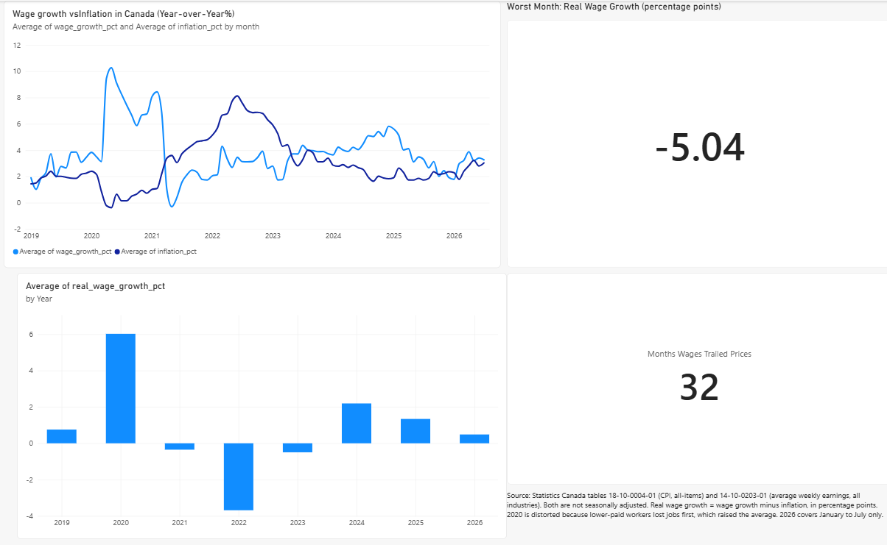

# Is Canada's Wage Growth Keeping Up With Prices?

An end-to-end analytics project using **SQL (PostgreSQL on Neon)** and **Power BI** to test whether Canadian wages kept pace with inflation between January 2018 and July 2026.



## Question

Did average weekly earnings grow faster or slower than consumer prices, and when did wages fall behind?

## Data

Both tables come from Statistics Canada (not seasonally adjusted, so year-over-year comparisons line up month to month):

| Table | Series used |
|---|---|
| 18-10-0004-01, Consumer Price Index, monthly, not seasonally adjusted | Canada, All-items (2002=100) |
| 14-10-0203-01, Average weekly earnings by industry, monthly, unadjusted for seasonality | Canada, all-industries total, all employees, including overtime |

Contains information licensed under the Statistics Canada Open Licence.

## Method

1. **Load.** Imported the two raw CSV files (1,577 CPI rows and 2,268 wage rows) into PostgreSQL staging tables with every column as text, so the import cannot fail on odd values (`SQL/01_create_raw_tables.sql`).
2. **Check.** Verified row counts, categories and date ranges before building on the data (`SQL/02_data_checks.sql`).
3. **Clean and transform.** Used SQL common table expressions (CTEs) to filter to one series per table, convert text to real dates and numbers (`TO_DATE`, `NULLIF`, `TRIM`, `::NUMERIC`), join the series by month, and calculate year-over-year change with the `LAG()` window function. Saved the result as a view, `wages_vs_inflation` (`SQL/03_create_view.sql`).
4. **Analyze.** Queried the view for the headline results (`SQL/04_findings.sql`).
5. **Visualize.** Connected Power BI directly to the view and built the dashboard.

Real wage growth is wage growth minus inflation, in percentage points. A negative value means prices grew faster than pay.

## Findings

Average real wage growth by year:

| Year | Avg real wage growth (percentage points) |
|---|---|
| 2019 | +0.76 |
| 2020 | +6.03 |
| 2021 | -0.35 |
| 2022 | -3.69 |
| 2023 | -0.50 |
| 2024 | +2.19 |
| 2025 | +1.34 |
| 2026 (January to July) | +0.49 |

- Wages trailed prices in 32 of the 91 months analysed (January 2019 to July 2026). The count matches between the SQL query and the Power BI dashboard.
- Wages trailed prices for three years in a row, from 2021 to 2023. 2022 was by far the worst, with inflation peaking that summer while wage growth stayed much lower.
- Wages caught up and moved ahead of prices from 2024 as inflation cooled.

## Limitations

- **2020 is distorted.** Lower-paid workers lost jobs first during COVID-19, which raised average weekly earnings without most people receiving a raise. The +6.03 figure reflects who was employed, not higher pay for individual workers.
- **2026 is a partial year** (January to July), so it should not be compared directly with full years.
- **Yearly figures are averages** of monthly year-over-year gaps. They show how fast wages grew relative to prices, not the total purchasing power lost over several years.
- **National averages.** The analysis covers all industries in Canada and does not show differences by sector, region or income level.

## Tools

PostgreSQL (Neon), SQL (CTEs, joins, window functions, views), DBeaver, Power BI, Statistics Canada open data, GitHub.

## Repository contents

```
SQL/
  01_create_raw_tables.sql
  02_data_checks.sql
  03_create_view.sql
  04_findings.sql
Dashboard.png
README.md
```
